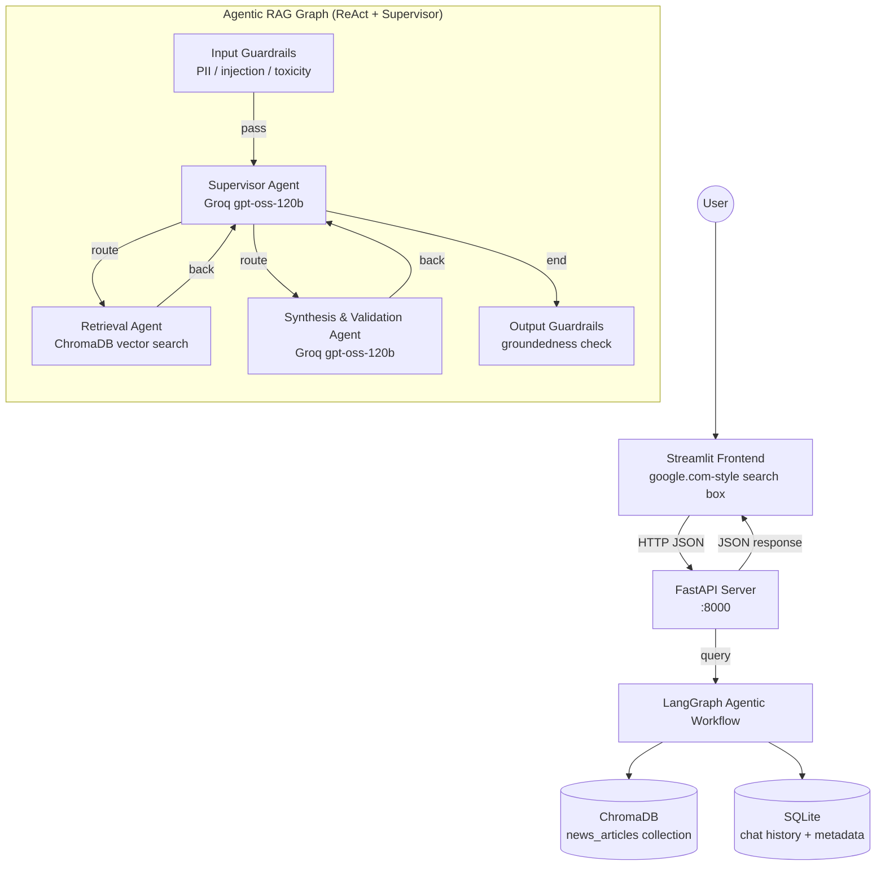
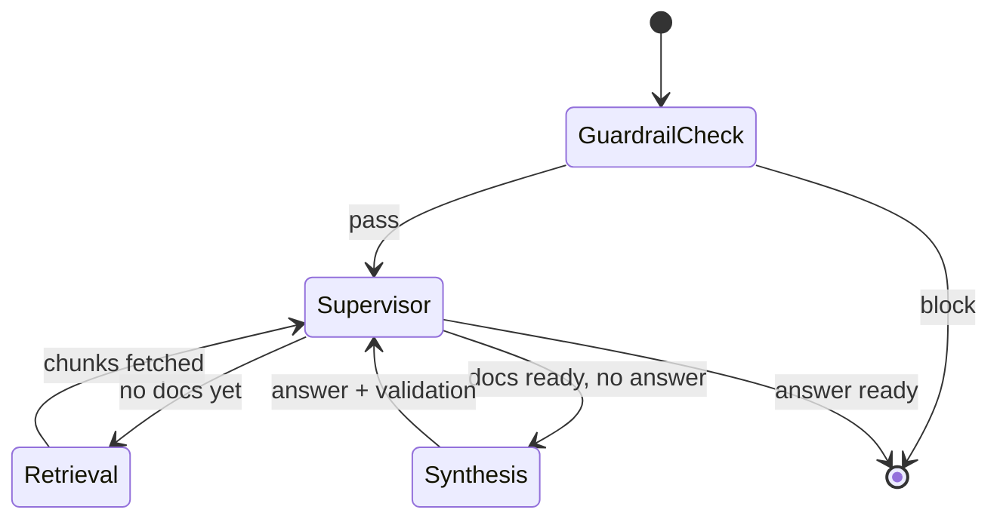
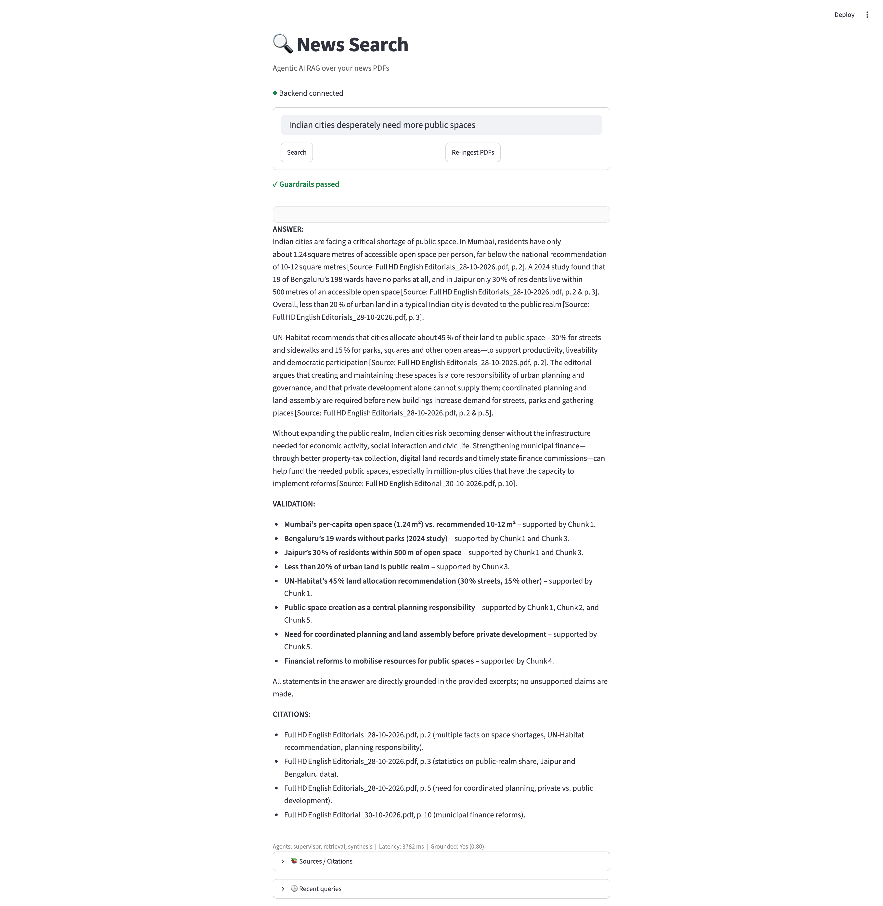

# 🗞️ Agentic AI RAG System — News Search

Production-grade Agentic Retrieval-Augmented Generation (RAG) system for searching across news PDFs.
Built with **LangChain + LangGraph (ReAct + Supervisor)**, **ChromaDB** (vector DB), **Groq** (LLM), **FastAPI + SQLite** (API), and **Streamlit** (frontend). Package management with **uv**.

---

## 1. High-Level Architecture



### Data flow
1. **User** types a query in the Streamlit search box (Google-like UI).
2. **FastAPI** receives the query at `POST /query/query`.
3. **LangGraph** runs the ReAct supervisor workflow: Input Guardrails → Supervisor → Retrieval → Supervisor → Synthesis → Supervisor → Output Guardrails.
4. **ChromaDB** stores news chunks; **SQLite** stores chat history + document metadata.
5. **Streamlit** renders the answer with citations, latency, and grounding score.


---

## 2. Detailed Workflow Diagram (LangGraph ReAct)



**ReAct loop:** Think (formulate search query) → Act (retrieve from ChromaDB) → Observe (score chunks) → (optionally repeat) → Answer. The Supervisor orchestrates this loop via conditional edges.

---

## 3. Folder Structure

| Path | Purpose |
|------|---------|
| `news/` | Source PDF news articles (6 editorials, Oct 2026) |
| `chroma_db/` | Persistent ChromaDB vector store |
| `newpaper_search.db` | SQLite database (chat sessions, messages, doc index) |
| `frontend/streamlit_app.py` | Google.com-style search UI |
| `scripts/ingest_pdfs.py` | Standalone ingestion script |
| `tests/test_rag.py` | Pytest suite |
| `src/newpapersearch/config.py` | Typed settings (pydantic-settings) from `.env` |
| `src/newpapersearch/models.py` | Shared Pydantic schemas |
| `src/newpapersearch/llm/groq_llm.py` | Groq LLM wrapper (reasoning vs fast model) |
| `src/newpapersearch/embeddings/embedding_provider.py` | Embedding abstraction (local BGE-small; Groq-ready) |
| `src/newpapersearch/vector/chroma_store.py` | ChromaDB wrapper (add/search/delete) |
| `src/newpapersearch/ingest/pdf_loader.py` | PDF text extraction (pypdf) |
| `src/newpapersearch/ingest/pipeline.py` | Load → split → embed → index pipeline |
| `src/newpapersearch/db/sqlite_db.py` | SQLAlchemy engine/session (SQLite) |
| `src/newpapersearch/db/models.py` | ORM models |
| `src/newpapersearch/db/crud.py` | CRUD operations |
| `src/newpapersearch/guardrails/safety.py` | Input/output safety & governance layer |
| `src/newpapersearch/agents/base.py` | Base agent class |
| `src/newpapersearch/agents/supervisor.py` | Supervisor routing agent |
| `src/newpapersearch/agents/retrieval.py` | Retrieval (ReAct) agent |
| `src/newpapersearch/agents/synthesis.py` | Synthesis & validation agent |
| `src/newpapersearch/agents/graph.py` | LangGraph ReAct workflow |
| `src/newpapersearch/api/main.py` | FastAPI application |
| `src/newpapersearch/api/deps.py` | FastAPI dependencies |
| `src/newpapersearch/api/schemas.py` | API request/response schemas |
| `src/newpapersearch/api/routers/{chat,ingest,health}.py` | API route handlers |
| `src/newpapersearch/cli.py` | CLI entry point |
| `requirements.txt` / `pyproject.toml` / `uv.lock` | Dependency manifest (uv) |
| `.env` | Secrets (GROQ_API_KEY) |


---

## 4. Libraries & Tools — Purpose

| Library / Tool | Use & Purpose |
|----------------|---------------|
| **uv** | Package manager & resolver (installs/locks all deps) |
| **python-dotenv / pydantic-settings** | Load & validate `.env` configuration |
| **langchain / langchain-core** | Core RAG abstractions (documents, embeddings, LLMs, chains) |
| **langchain-groq** | Groq LLM client integration |
| **langchain-huggingface / sentence-transformers** | Local embeddings (BAAI/bge-small-en-v1.5) |
| **langchain-chroma / chromadb** | Vector store: persist + similarity search over news chunks |
| **langchain-text-splitters** | Recursive character text chunking |
| **langgraph** | Agentic orchestration: supervisor + ReAct conditional graph |
| **pypdf / fonttools** | PDF text extraction |
| **fastapi / uvicorn** | High-performance async REST API |
| **sqlalchemy** | SQLite ORM for chat history & document metadata |
| **streamlit** | Minimal Google-like search frontend |
| **requests / httpx** | HTTP clients (frontend → API) |
| **beautifulsoup4** | HTML/text utilities |
| **pytest / pytest-asyncio** | Unit & async testing |

> **Note on Groq embeddings:** Groq is an inference (LLM) provider and does **not** offer a text-embedding API. The system therefore generates embeddings locally with **sentence-transformers (BAAI/bge-small-en-v1.5, 384-dim)** via a swappable `EmbeddingProvider` abstraction. If/when Groq releases embeddings, only `embedding_provider.py` needs a new class — no agent or vector-store code changes. Groq powers **all** LLM/agent reasoning (supervisor, retrieval reasoning, synthesis, validation, guardrails).

---

## 5. Comparison with Other Possible Workflows

| Approach | How it works | Pros | Cons | Why we chose ours |
|----------|-------------|------|------|-------------------|
| **Naive RAG** (retrieve → generate) | Single pass: embed query → search vector DB → ask LLM | Simple, fast | No reasoning loop, no validation, no citations guardrail, hallucination risk | Ours adds supervision, validation, and guardrails for correctness and safety |
| **Single ReAct agent** | One agent does retrieve + reason + answer in a loop | Flexible | Hard to steer, no separation of concerns, single point of failure | Ours splits retrieval/synthesis/supervision for clarity and testability |
| **Supervisor-only (no ReAct)** | Supervisor routes to one tool and ends | Predictable | No retrieval-observation loop; can't refine a bad search | Ours loops retrieval back to supervisor until evidence is sufficient |
| **Agentic RAG (ours)** | Supervisor + ReAct retrieval + Synthesis+Validation + dual guardrails | Grounded answers, citations, safety, observable, extensible | Slightly higher latency (multiple LLM calls) | **Best for production news search** where accuracy, traceability, and safety matter more than single-shot speed |

---

## 6. Why This Is the Best & Complete Architecture

1. **Separation of concerns** — Supervisor (routing), Retrieval (evidence), Synthesis+Validation (answer + groundedness), Guardrails (safety). Each independently testable.
2. **ReAct loop** — Retrieval can be refined: if chunks are insufficient, the supervisor routes back to retrieval with a better query.
3. **Grounding & citations** — Every answer cites source file + page; validation scores groundedness, reducing hallucinations.
4. **Defence-in-depth safety** — Input guardrails block injection/PII/toxicity; output guardrails verify groundedness before returning.
5. **Production-grade persistence** — ChromaDB for vectors; SQLite for chat history and document metadata; both queryable via FastAPI.
6. **Best available models** — Groq `gpt-oss-120b` for reasoning (supervisor/synthesis) and `gpt-oss-20b` for fast tasks (guardrails); BGE-small for embeddings.
7. **Observable & extensible** — `agents_used`, `latency_ms`, `groundedness_score`, and `citations` returned on every response; new agents/providers plug into the graph cleanly.
8. **Simple, Google-like frontend** — One search box; works immediately against the FastAPI backend.


---

## 7. Setup & Installation (uv)

```bash
# 1. Open the project
cd /Users/dixika/Documents/NewpaperSearch

# 2. Confirm .env has your Groq key
cat .env
# GROQ_API_KEY=gsk_...

# 3. Install dependencies with uv
uv sync                    # or: uv pip install -r requirements.txt

# 4. Activate the venv (optional)
source .venv/bin/activate
```

---

## 8. Usage

### A) Ingest news PDFs into ChromaDB
```bash
# CLI
uv run newpapersearch ingest --reset

# or via script
uv run python scripts/ingest_pdfs.py

# or via FastAPI
curl -X POST "http://localhost:8000/ingest/ingest?reset=true"
```
Result: 6 documents → 3,580 chunks indexed.

### B) Run the FastAPI backend
```bash
uv run uvicorn newpapersearch.api.main:app --reload
# API docs: http://localhost:8000/docs
# Health:   http://localhost:8000/health
```
Endpoints: `POST /query/query`, `POST /ingest/ingest?reset=true`, `GET /health`.

### C) Run the Streamlit frontend
```bash
streamlit run frontend/streamlit_app.py
# Opens: http://localhost:8501
```
Type a question in the centered search box (Google-like). Get an answer with citations, grounding score, agents used, and latency.

### D) Programmatic Python API
```python
from newpapersearch.agents.graph import build_graph, invoke_rag

graph = build_graph()
state = invoke_rag(graph, query="What were the main headlines this week?", top_k=5)
print(state["final_answer"])
print("Grounded:", state["validation"].is_grounded)
for c in state["citations"]:
    print(c.source_file, c.page_number)
```

### E) CLI
```bash
uv run newpapersearch ingest --reset
uv run newpapersearch
```

---

## 9. Configuration (`.env`)

```env
GROQ_API_KEY=gsk_XXXXXXXXXXXXXXXXXXXX
```

Override via environment variables (pydantic-settings reads `.env`):
- `GROQ_MODEL_REASONING` (default: `openai/gpt-oss-120b`)
- `GROQ_MODEL_FAST` (default: `openai/gpt-oss-20b`)
- `GROQ_TEMPERATURE` (default: `0.2`)
- `CHROMA_TOP_K` (default: `5`)
- `CHUNK_SIZE` / `CHUNK_OVERLAP`
- `ENABLE_INPUT_GUARDRAILS` / `ENABLE_OUTPUT_GUARDRAILS`

> Model availability depends on your Groq account/key. Set `GROQ_MODEL_REASONING`/`GROQ_MODEL_FAST` to models your key can access.

---

## 10. Safety & Governance Guardrails

- **Input guardrails:** regex-based prompt-injection / jailbreak detection, PII scanning (emails, phones, cards, SSN-like), toxicity keyword scan, max-length check. Verdicts: `PASS`, `SANITIZE`, or `BLOCK`.
- **Output guardrails:** LLM-backed groundedness check against retrieved sources; empty-response handling.
- Both layers run on the fast Groq model (`gpt-oss-20b`) and fail-open on LLM errors.

---

## 11. Testing

```bash
uv run pytest tests/ -v
```
Current suite: 4 passed, 1 skipped (embedding test skipped unless `GROQ_API_KEY` is exported to the shell).

---

## 12. Running the complete system (`newssearch` command)

A convenience CLI command `newssearch` is installed with the package to start,
stop and restart the entire stack (FastAPI on port 8000 + Streamlit on port 8501).

```bash
# Activate the venv first (one-time per shell)
source .venv/bin/activate

# Start everything
newssearch --start

# Stop everything
newssearch --stop

# Restart everything
newssearch --restart

# Help
newssearch --help
```

What it does:
- **`--start`** launches `uvicorn newpapersearch.api.main:app` (FastAPI, `:8000`) and
  `streamlit run frontend/streamlit_app.py` (Streamlit, `:8501`) in the background,
  writes their PIDs to `.run/pids.json`, and logs to `.run/fastapi.log` and
  `.run/streamlit.log`.
- **`--stop`** kills both services and releases ports 8000 / 8501.
- **`--restart`** stops then starts the full stack.

After `--start`, open:
- **Streamlit UI:** http://localhost:8501 (Google-like search box)
- **FastAPI docs:** http://localhost:8000/docs
- **Health:** http://localhost:8000/health

---

## 📸 Snapshots

Live screenshots of the running Streamlit frontend (`http://localhost:8501`).

### Home page — Google-like search box


### Results page — answer with citations & grounding



---

## 13. Summary

This is a complete, production-grade Agentic AI RAG system:
- **Vector DB:** ChromaDB (persistent)
- **Orchestration:** LangGraph supervisor + ReAct agents
- **LLM:** Groq (`gpt-oss-120b` reasoning / `gpt-oss-20b` fast)
- **Embeddings:** Local BGE-small via swappable abstraction (Groq-ready)
- **API:** FastAPI + SQLite
- **Frontend:** Streamlit (Google-like)
- **Safety:** Dual input/output guardrail layer
- **Package manager:** uv

